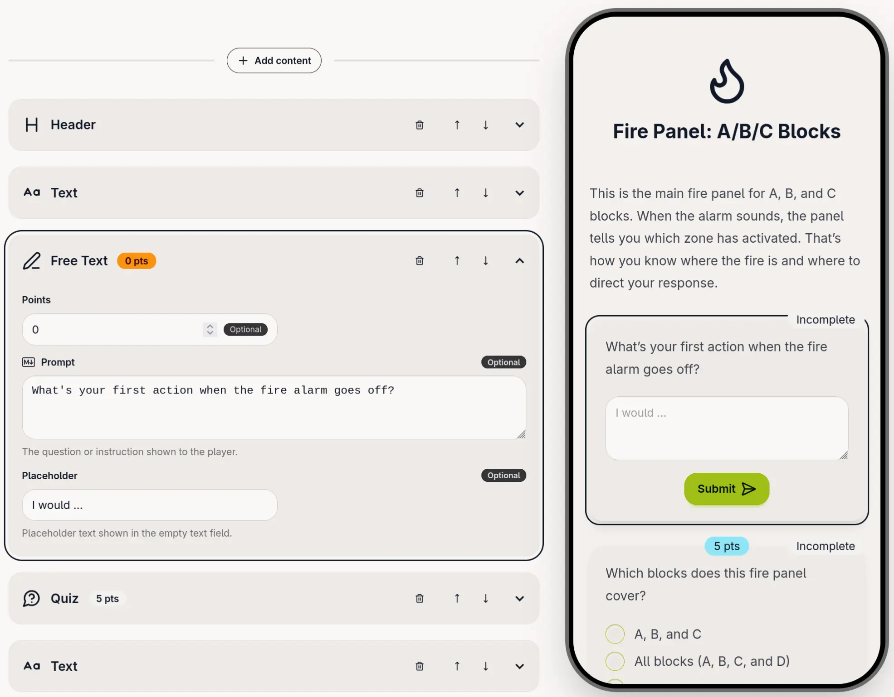

# Free Text Block

The free text block provides an open-ended text input for player reflections and free-form responses. Use this for moments where articulating an experience matters more than selecting from options: "describe what you see", "what does this smell like?", or "how does this make you feel?"

Unlike quiz or password blocks, any non-empty response is accepted. If points are enabled, participants are awarded points when they submit their response.

## Notes

- A response can be edited after it is sent: an "Edit answer" button reopens it, and saving needs a change. Points are awarded once
- The submitted response is displayed back to the player as a blockquote
- The prompt field supports [Markdown](/docs/user/markdown-guide) for rich text formatting
