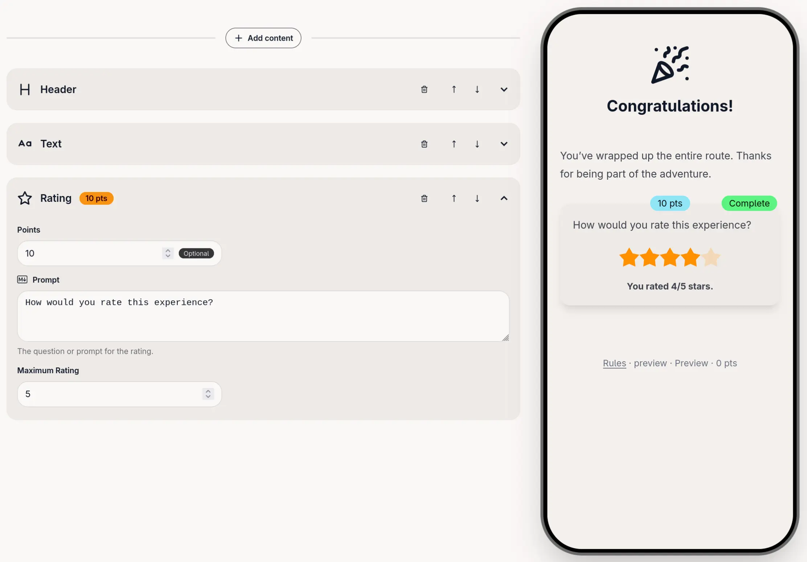

# Rating Block

The rating block enables participants to provide star ratings for feedback or assessment. Use this to gather feedback about experiences, difficulty, or content quality.

## Configuration

- **Prompt**: The question or statement participants are rating
- **Points**: Award points when participants submit their rating (all ratings award equal points)

Every rating is out of five stars.

## Notes

- Ratings cannot be changed once submitted
- Ideal for finish pages to gather post-game feedback

